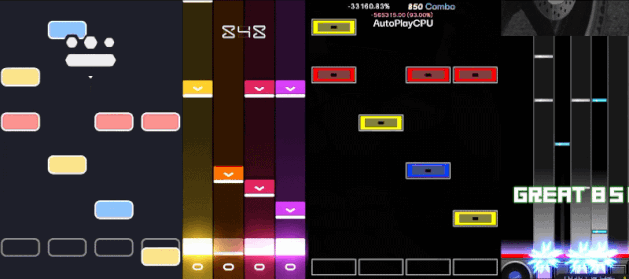

# Universal Beatmap Extractor - UBE
UBE is a utility for converting, modifying, and packaging beatmaps across different rhythm game formats, including osu!mania, Quaver, StepMania, and BMS.

I really wanted to play one beatmap from a different game, in a client that I prefered, so I found other tools that had this capability to convert formats but it required you to download them and configure (面倒くさい) or it just wasn't their main functionality so I wanted something quick, have it open sourced, and easy to use so I could convert one game format beatmap to another.

Import individual charts or entire song packs, choose your target format, and download. UBE handles parsing, file organization, and packaging automatically.

It was important to me that there was **_no installation, account, or backend server required_** so all beatmap processing happens locally in your browser. Future development plans include a seperate standalone release with UBE's core written in C#.

Developed by [Robbie Yamashita](https://wobbie.me).

## Features
- **Cross-format conversion**: Convert between supported mania rhythm game formats.
- **Drag-and-drop importing**: Upload individual files, folders, or supported archives.
- **Archive handling**: Import `.zip`, `.osz`, `.qp`, and ZIP-based `.olz` packages, including nested archives.
- **Automatic packaging**: Generate `.osz` and `.qp` mapsets when the required files are available, or organized ZIP exports where appropriate.
- **Batch processing**: Convert multiple songs and difficulties together, including mixed source formats.
- **Beatmap editing**: Modify metadata, difficulty settings, timing offsets, lane orientation, and supported asset references before conversion.
- **Asset preservation**: Retain compatible audio, images, and supporting files while preserving meaningful song-folder structure.
- **Conversion reports**: View warnings, unsupported features, and files that could not be converted.
- **UBE format**: Inspect, import, and export normalized `.ube` JSON beatmaps.
- **Client-side processing**: Parsing, serialization, audio processing, and ZIP creation run in the browser using Web Workers.

## Supported formats
| Game / Format | Extensions | Import | Export |
|---|:---|:---:|:---:|
| osu!mania | `.osu`, `.osz` | ✅ | ✅ |
| Quaver | `.qua`, `.qp` | ✅ | ✅ |
| StepMania / Etterna | `.sm` | ✅ | ✅ |
| StepMania (Legacy) | `.dwi` | ✅ | ❌ |
| Beatmania BMS | `.bms`, `.bme`, `.bml` | ✅ | `.bms` |
| Pop'n Music (PMS) | `.pms` | ✅ | ❌ |
| Universal Beatmap | `.ube` | ✅ | ✅ |

UBE also supports generic ZIP archives containing compatible charts and song assets.

> [!NOTE]
> Format support does not guarantee that every game-specific feature can be translated. Certain timing behaviors, note types, effects, and metadata may differ between games.

To demonstrate a specific game feature, I had tested the conversion formats with a heavy slider velocity beatmap from Quaver; [Elevator - Eliminate [Belly Of The Beast]](https://quavergame.com/mapsets/15045/maps/80982). Quaver supports values of zero, negative, and positive slider velocities. osu!mania supports a slider velocity between `0.1` and `10`. StepMania, and Beatmania do not support slider velocities within their mapping formats so they are omitted in the converted beatmaps.

> [!INFO]
> The translation of slider velocities between all formats with the Elevator beatmapset. left to right: Quaver, osu!, StepMania, BMS 


## How to use

1. **Import**: Drag and drop beatmaps, song folders, or archives into UBE, or use the file picker.
2. **Select**: Choose which songs and difficulties to convert.
3. **Edit (optional)**: Adjust supported beatmap properties before exporting.
4. **Convert**: Select the destination format and start conversion.
5. **Download**: Save the converted chart, song package, or ZIP archive.

> [!NOTE]
> UBE attempts to preserve the original song structure and its compatible assets. Where possible, it creates a native `.osz` or `.qp` package automatically so you can just import in the game's client.

If a complete native package cannot be constructed, UBE uses an appropriate file or ZIP export and explains the reason in the conversion report.

## Compatibility and limitations
Beatmap formats represent timing, note types, scrolling behavior, and audio differently. While I had attempted to preserve the compatible information, _conversion is not always lossless_.

Some important limitations:

- **Timing:** Stop events, scroll velocities, and beat-grid resolution can differ between formats. StepMania and BMS output may require some timing quantizations.
- **Note types:** Unsupported note types may be omitted or converted to the closest supported equivalent, with warnings.
- **Assets:** Common audio formats (MP3, OGG, WAV) and images (PNG, JPEG) are supported for portable packaging. Unsupported media may be omitted; images, videos, and audio are not generally transcoded.
- **Difficulty settings:** Editing the difficulty values does not automatically rebalance or regenerate note patterns.
- **BMS audio:** It can mix available BMS keysounds into a WAV file when the necessary samples are present and can be decoded. Missing samples may prevent audio mixing.
- **Advanced features:** Certain BMS conditional commands, Quaver timing-group effects, StepMania attacks, and game-specific scripting features are not fully supported 😕
- **Game compatibility:** Generated packages should be checked in their destination game. Structurally valid output does not guarantee identical gameplay or complete compatibility.

> [!TIP]
> For best results, import the entire song folder or archive rather than an isolated chart, especially when the chart references external assets.

UBE provides conversion warnings and reports so unsupported or altered information can be identified.

### Processing limits
To preserve browser responsiveness, and compatibility with small systems, the following limits are applied:

| Resource | Limit |
|---|---|
| Expanded data per import | 512 MiB |
| Entries per import | 10,000 |
| Nested archive depth | 5 levels |
| Chart text size | 32 MiB |
| Notes per chart | 500,000 |
| BMS audio mix duration | 10 minutes |

Large archives and audio operations may consume significant browser memory.

## Privacy and browser support
**UBE is a static site. It does not require an account or upload beatmap files to an application server.**

All chart parsing, editing, conversion, and packaging are performed locally in your browser. Refreshing the page clears the current workspace so be careful.

UBE requires a modern browser supporting JavaScript ES module workers and the Popover API. Chromium based browsers have been tested- compatibility with other browsers has not been fully verified.

## Development

Built with vanilla JavaScript, HTML, and Tailwind CSS. It is hosted as a static website through GitHub Pages.

The repository includes the compiled stylesheet and browser dependencies, so **Node.js is not required to use or host the application**.

To run the site locally, serve the repository root through an HTTP server:

```bash
python -m http.server 8000
```

Then open `http://localhost:8000`.

Opening `index.html` directly through `file://` is not supported because the application uses JavaScript module workers, sorry 😞

### Building from source

Node.js is only needed for development and rebuilding assets.

```bash
npm ci
npm run build
```

This regenerates the Tailwind stylesheet and locally vendored browser dependencies.

For development with live reload:

```bash
npm run dev
```

The live site requires only the static HTML, compiled CSS, JavaScript modules, images, and vendored libraries.

## License

UBE is released under the [ISC License](LICENSE).

The project uses third-party open-source dependencies, including JSZip and js-yaml. Their original licenses and acknowledgments are preserved in [`vendor/`](vendor/) and [`licenses/`](licenses/THIRD-PARTY-NOTICES.md).

UBE's parsers and serializers are independent implementations informed by publicly documented rhythm-game file formats and relevant format references.

UBE is an independent project and is not affiliated with or endorsed by the developers of osu!, Quaver, StepMania, Etterna, beatmania IIDX, or other supported games.

---

**UBE © 2026 Robbie Yamashita**

[Portfolio](https://wobbie.me) · [GitHub](https://github.com/wwobbiee)